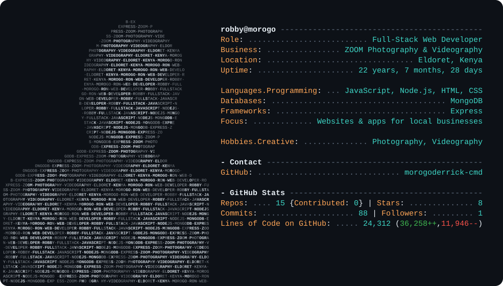

<a href="https://github.com/morogoderrick-cmd">
  <picture>
    <source media="(prefers-color-scheme: dark)"  srcset="dark_mode.svg">
    <source media="(prefers-color-scheme: light)" srcset="light_mode.svg">
    
  </picture>
</a>

Card layout inspired by [Andrew6rant](https://github.com/Andrew6rant)'s profile README.
